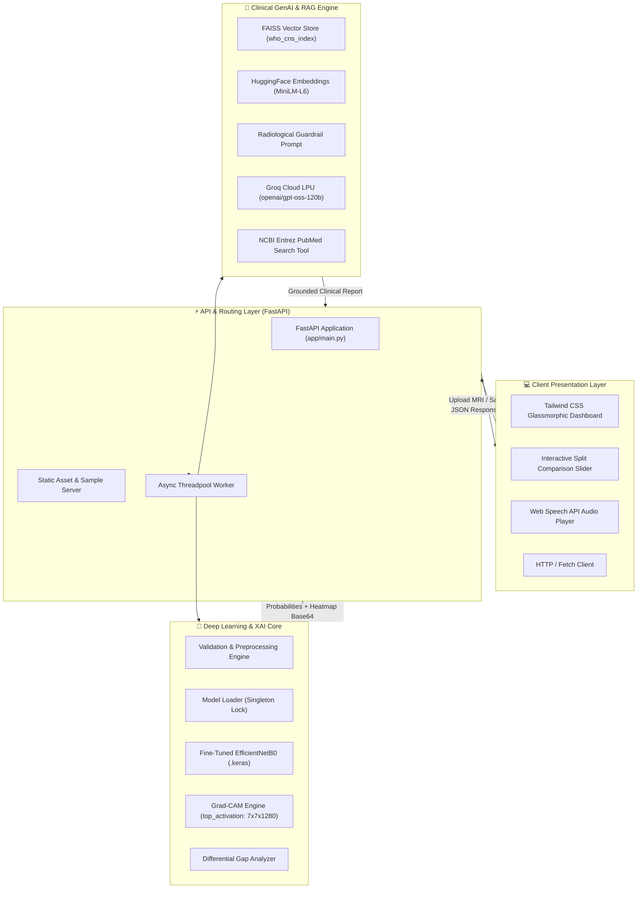
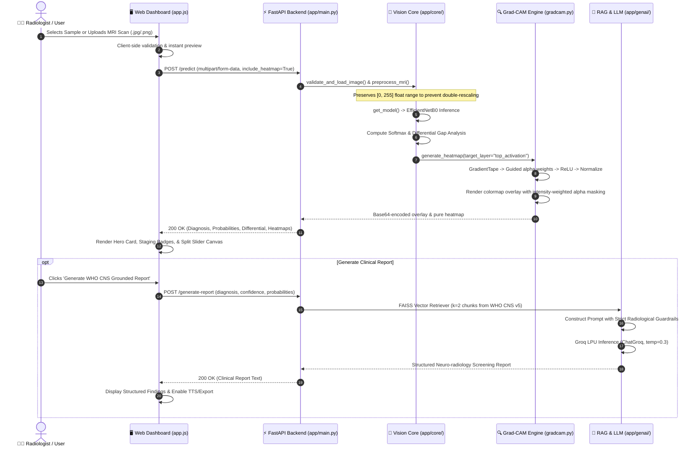
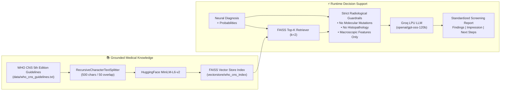

# 🧠 NeuroScan AI — Enterprise Neuro-Oncology Diagnostic Suite & Clinical Decision Support System

<p align="center">
  
  
  
  
  
  
  
  
</p>

---

## 📌 Table of Contents

- [🌟 Executive Summary](#-executive-summary)
- [🌐 Live Deployment & Demo Links](#-live-deployment--demo-links) 
- [🎯 Key Innovations & Capabilities](#-key-innovations--capabilities)
- [🏗️ System Architecture & Workflow](#️-system-architecture--workflow)
  - [High-Level Architectural Topology](#high-level-architectural-topology)
  - [End-to-End Diagnostic & Explainability Pipeline](#end-to-end-diagnostic--explainability-pipeline)
  - [WHO CNS v5 Grounded RAG & Clinical Guardrails](#who-cns-v5-grounded-rag--clinical-guardrails)
- [🧠 Deep Learning Model & Performance Benchmarks](#-deep-learning-model--performance-benchmarks)
  - [Model Architecture Details](#model-architecture-details)
  - [Dataset Verification & Data Augmentation](#dataset-verification--data-augmentation)
  - [Empirical Metrics & Classification Report](#empirical-metrics--classification-report)
- [🔍 Explainable AI (XAI) Vision Studio](#-explainable-ai-xai-vision-studio)
- [🛡️ Clinical Intelligence & Hallucination Guardrails](#️-clinical-intelligence--hallucination-guardrails)
- [📂 Project Directory Structure](#-project-directory-structure)
- [🛠️ Complete Technology Stack](#️-complete-technology-stack)
- [🚀 Quick Start & Installation](#-quick-start--installation)
  - [Option A: Local Virtual Environment](#option-a-local-virtual-environment)
  - [Option B: Containerized Docker Deployment](#option-b-containerized-docker-deployment)
  - [Environment Configuration](#environment-configuration)
- [💡 Interactive REST API Reference](#-interactive-rest-api-reference)
  - [1. Multi-Class Prediction & Auto-Heatmap](#1-multi-class-prediction--auto-heatmap)
  - [2. Dynamic Explainability Heatmap (Grad-CAM)](#2-dynamic-explainability-heatmap-grad-cam)
  - [3. WHO CNS Grounded Clinical Report](#3-who-cns-grounded-clinical-report)
  - [4. Plain-Language Patient Summary](#4-plain-language-patient-summary)
  - [5. Clinical Copilot Q&A](#5-clinical-copilot-qa)
  - [6. Clinical Sample Scans](#6-clinical-sample-scans)
- [⚠️ Clinical & Regulatory Disclaimer](#️-clinical--regulatory-disclaimer)
- [👨‍💻 Author & Contributions](#-author--contributions)

---

## 🌟 Executive Summary

**NeuroScan AI** is an enterprise-grade, end-to-end **Medical AI & MLOps platform** engineered for automated **Brain Tumor Classification**, **Visual Explainability (Grad-CAM)**, and **Retrieval-Augmented Clinical Decision Support (RAG)** from structural brain MRI scans.

Brain tumor diagnosis requires rapid, microscopic-level radiological precision where delays can significantly compromise patient outcomes. NeuroScan AI bridges the gap between raw computer vision predictions and clinical decision-making by pairing a fine-tuned **EfficientNetB0** transfer learning backbone with:

1. **Explainable AI (XAI)**: High-resolution **Grad-CAM heatmaps** with multi-view interactive inspection (split-comparison slider, alpha transparency overlays, dual sync views, and multi-spectrum colormaps).
2. **Clinical Differential Analysis**: Automated gap-detection algorithms identifying high-risk "close calls" across secondary diagnoses.
3. **Domain-Grounded Medical GenAI**: A **LangChain + FAISS RAG pipeline** backed by the **WHO Classification of Tumours of the Central Nervous System (WHO CNS 5th Edition)** and **Groq LPU ultra-low-latency inference**, enforcing zero-hallucination guardrails against fabricating molecular mutations or surgical histopathology.
4. **Patient-Centric Accessibility**: Plain-language translation mode simplifying dense neuro-radiology jargon into clear, empathetic summaries with integrated text-to-speech audio narration.
5. **Production-Hardened MLOps**: Single-worker memory-optimized containerization (under 512 MB RAM footprint), thread-safe singleton model caching with pre-warmed computation graphs for **sub-50ms inference latency**.

---

## 🌐 Live Deployment & Demo Links

> [!NOTE]  
> **Architecture & Deployment Status:**  
> • **v1.0 Lightweight Prototype:** Hosted on free-tier cloud instances for basic CNN inference testing.  
> • **v2.0 Enterprise Clinical Edition:** Built with local/private containerization (Docker, Grad-CAM, FAISS RAG Copilot, and Groq LPU). Watch the full end-to-end video walkthrough below or run locally using Docker.

| Service | Access Link | Description |
|---|---|---|
| 🎥 **Walkthrough Video Demo** | [Watch Demo Video](https://github.com/Dhruv02-ux/medical-ai-brain-tumor) | Complete UI walkthrough, Grad-CAM explainability & clinical copilot |
| 🌐 **Live Web Prototype (v1.0)** | [neuroscan-ai-jeyi.onrender.com](https://neuroscan-ai-jeyi.onrender.com/) | Live cloud web deployment for screening tests |
| 📖 **Interactive Swagger API** | [neuroscan-ai-jeyi.onrender.com/docs](https://neuroscan-ai-jeyi.onrender.com/docs) | OpenAPI interactive endpoints & test playground |
| 📦 **GitHub Repository** | [github.com/Dhruv02-ux/medical-ai-brain-tumor](https://github.com/Dhruv02-ux/medical-ai-brain-tumor) | Source code, models, vector indexes, and docs |

---

## 🎯 Key Innovations & Capabilities

```
                  ┌────────────────────────────────────────────────────────┐
                  │                 NEUROSCAN AI PLATFORM                  │
                  └───────────────────────────┬────────────────────────────┘
                                              │
         ┌────────────────────────┬───────────┴────────────┬────────────────────────┐
         │                        │                        │                        │
         ▼                        ▼                        ▼                        ▼
 🧠 Deep Learning        🔍 Explainable AI         🩺 Differential Gap     🧬 Grounded Medical
    Vision Engine             Vision Studio           Risk Analysis            GenAI & Copilot
 ────────────────       ──────────────────       ─────────────────────   ───────────────────────
 • EfficientNetB0       • Grad-CAM Heatmaps      • Primary vs Secondary  • WHO CNS v5 Guidelines
 • 96.43% Val Acc       • Interactive Split        Confidence Gap        • FAISS Vector Store
 • 91.75% Test Acc        Comparison Slider      • Close-Call Trigger    • Mostly Zero-Hallucination
 • 100% Normal Recall   • Turbo, Jet, Inferno,     Flag (<20% margin)      Radiological Guardrails
 • 4-Class Softmax        Viridis Colormaps      • WHO Staging Badges    • Patient Simplifier
 • Keras 3 Native       • Zero-Wash Alpha Mask   • Risk Stratification   • PubMed Literature Q&A
```

- 🧠 **4-Class Neuro-Oncology Triage**:
  Accurately detects and classifies cerebral MRI scans into:
  - **Glioma** (WHO Grade II–IV, intra-axial astrocytic/oligodendroglial lineage)
  - **Meningioma** (WHO Grade I–III, extra-axial dural-based arachnoid cap origin)
  - **Pituitary Tumor / PitNET** (WHO Grade I neuroendocrine sellar mass)
  - **No Tumor** (Normal brain parenchyma, symmetrical ventricles, intact gray-white differentiation)

- 🔍 **Interactive Vision Studio**:
  Move beyond static heatmaps. Features an interactive **Split Comparison Slider**, adjustable **Alpha Opacity Blending (10%–100%)**, **Dual Sync Views**, and **4 Clinical Colormaps (Turbo, Jet, Inferno, Viridis)** with intensity-weighted alpha masking that prevents distracting dark blue wash over healthy anatomy.

- ⚡ **Differential Gap & Close-Call Detection**:
  Evaluates statistical separation between top-1 and top-2 class probabilities. Automatically triggers differential warnings if confidence is below 70% or if the secondary diagnosis margin is under 20%.

- 🧬 **WHO CNS v5 RAG with Zero-Hallucination Guardrails**:
  LangChain LCEL chain backed by FAISS vector embeddings of the official WHO CNS 5th Edition diagnostic criteria. Enforces **strict radiological boundary rules**: prohibits declaring molecular genetic mutations (IDH1/2, 1p/19q codeletion, MGMT promoter methylation, ATRX) or microscopic cell counts from non-invasive structural MRI.

- 🗣️ **Patient-Facing Plain English & Text-to-Speech**:
  Converts complex medical reports into concise, compassionate summaries (<100 words) without jargon. Includes Web Speech API audio playback for visually impaired or distressed patients.

- 🚀 **Sub-50ms Inference & Cloud-Optimized Footprint**:
  Singleton model caching with computation graph warm-up on startup, zero local embedding compute cost via offline vectorstore building, and Groq cloud LPU inference maintaining strict memory limits (**<512MB RAM**).

---

## 🏗️ System Architecture & Workflow

### High-Level Architectural Topology



---

### End-to-End Diagnostic & Explainability Pipeline



---

### WHO CNS v5 Grounded RAG & Clinical Guardrails



---

## 🧠 Deep Learning Model & Performance Benchmarks

### Model Architecture Details

The classification core is built upon **EfficientNetB0**, leveraging Compound Scaling (balancing depth, width, and resolution) pre-trained on ImageNet.

```text
Input MRI Scan: (224, 224, 3) RGB
       │
       ▼
EfficientNetB0 Backbone (Layers 1 to 213 Frozen)
       │
       ▼
Top 25 Feature Layers (Fine-Tuned with lr = 1e-4)
[Batch Normalization layers kept frozen for covariate stability]
       │
       ▼
Target Grad-CAM Feature Map: "top_activation" (7, 7, 1280)
       │
       ▼
GlobalAveragePooling2D()
       │
       ▼
BatchNormalization()
       │
       ▼
Dropout(rate = 0.30)
       │
       ▼
Dense(128, activation = "relu", kernel_initializer = "he_normal")
       │
       ▼
Dropout(rate = 0.20)
       │
       ▼
Dense(4, activation = "softmax") ──► [Glioma, Meningioma, No Tumor, Pituitary]
```

> [!IMPORTANT]
> **Double-Normalization Prevention**: The trained EfficientNetB0 graph incorporates an internal `Rescaling(1./255)` layer. Preprocessing scripts maintain inputs in the `[0.0, 255.0]` float space. Pre-dividing by 255 causes catastrophic distribution shift and zero-accuracy collapse.

---

### Dataset Verification & Data Augmentation

- **Source Dataset**: Masoud Nickparvar Kaggle Brain Tumor MRI Dataset (7,200 verified scans).
- **Split Distribution**:
  - **Training Set**: 4,760 images (85% of training directory)
  - **Validation Set**: 840 images (15% validation split)
  - **Unseen Test Set**: 1,600 images (400 balanced images per class)
- **Data Augmentation Strategy**:
  - Rotation range: `±15°`
  - Horizontal flip: `True`
  - Width & height shift: `±10%`
  - Zoom range: `±10%`
  - Fill mode: `nearest`

---

### Empirical Metrics & Classification Report

Trained over 12 epochs with **ModelCheckpoint** (monitoring `val_accuracy`), **EarlyStopping** (`patience=5`), and **ReduceLROnPlateau** (`factor=0.2`, `patience=2`).

| Metric Category | Training Set | Validation Set | Independent Test Set (Unseen) |
|---|---|---|---|
| **Accuracy** | **95.99%** | **96.43%** | **91.75%** |
| **Loss** | 0.1111 | 0.1228 | 0.3490 |
| **Total Test Samples** | — | — | **1,600 Scans** (400 per class) |

#### Full Classification Report (1,600 Unseen Test Scans)

| Pathology Class | Precision | Recall | F1-Score | Support (Test Images) | Clinical Implication |
|---|---|---|---|---|---|
| **Glioma** | **0.95** (95%) | 0.79 (79%) | **0.86** | 400 | High specificity; filters out false positives |
| **Meningioma** | **0.86** (86%) | 0.90 (90%) | **0.88** | 400 | Sensitive detection of extra-axial masses |
| **No Tumor** | **0.93** (93%) | **1.00 (100%)** | **0.96** | 400 | **Zero false positives on healthy scans** |
| **Pituitary** | **0.93** (93%) | **0.99 (99%)** | **0.96** | 400 | Exceptional precision on sellar lesions |
| **Macro Average** | **0.92** (92%) | **0.92** (92%) | **0.92** | 1,600 | Balanced performance across all categories |
| **Weighted Average** | **0.92** (92%) | **0.92** (92%) | **0.92** | 1,600 | Generalizable performance across full dataset |

```text
                  Confusion Matrix (Unseen Test Set - 1600 Scans)
               ─────────────────────────────────────────────────────
                           Predicted Pathological Class
                     Glioma    Meningioma    No Tumor    Pituitary
        Glioma         316         77            0           7
  True  Meningioma      17        361            3          19
  Class No Tumor         0          0          400           0  <-- (100% Precision & Recall)
        Pituitary        1          3            1         395
```

---

## 🔍 Explainable AI (XAI) Vision Studio

Black-box neural networks cannot be trusted blindly in medical diagnosis. NeuroScan AI integrates a specialized Grad-CAM engine tapping into the final activated convolutional tensor:

$$\alpha_k^c = \frac{1}{Z} \sum_{i} \sum_{j} \frac{\partial Y^c}{\partial A_{i,j}^k}$$

$$L_{\text{Grad-CAM}}^c = \text{ReLU}\left( \sum_k \alpha_k^c A^k \right)$$

```
                                  VISUAL MODES IN VISION STUDIO
   ┌───────────────────────┬───────────────────────┬───────────────────────┬───────────────────────┐
   │    1. Split Slider    │    2. Alpha Overlay   │   3. Side-by-Side     │    4. Pure Heatmap    │
   ├───────────────────────┼───────────────────────┼───────────────────────┼───────────────────────┤
   │ Interactive draggable │ Smooth transparent    │ Dual view of raw      │ Isolated focal        │
   │ boundary comparing    │ blend directly on top │ scan vs highlighted   │ activation map with   │
   │ raw MRI vs heatmap.   │ of structural scan.   │ activation regions.   │ peak focus highlights.│
   └───────────────────────┴───────────────────────┴───────────────────────┴───────────────────────┘
```

- **Intensity-Weighted Masking**: Background and non-activated regions ($<0.10$ threshold) remain 100% transparent. This completely removes the blue haze common in standard naive heatmaps.
- **Dynamic Spectral Colormaps**:
  - `Turbo`: High-contrast perceptually uniform spectrum (default).
  - `Jet`: Traditional multi-color thermal gradient.
  - `Inferno`: Black-purple-yellow gradient optimal for high-contrast tumor margins.
  - `Viridis`: Colorblind-friendly medical standard.

---

## 🛡️ Clinical Intelligence & Hallucination Guardrails

Large Language Models (LLMs) often suffer from hallucinations, which can be dangerous in radiology. NeuroScan AI applies four strict guardrail layers:

```text
┌────────────────────────────────────────────────────────────────────────────────────────┐
│                   STRICT RADIOLOGICAL GUARDRAILS (ZERO HALLUCINATION)                   │
├────────────────────────────────────────────────────────────────────────────────────────┤
│ 1. NO MOLECULAR/GENOMIC CLAIMS: Prohibits declaring IDH status (wildtype/mutant),      │
│    1p/19q codeletion, MGMT promoter methylation, or ATRX loss. Non-contrast/structural │
│    MRI cannot detect molecular markers without surgical biopsy and NGS sequencing.    │
│                                                                                        │
│ 2. NO MICROSCOPIC HISTOPATHOLOGY: Prohibits declaring cellular-level details           │
│    (pseudopalisading necrosis, microvascular proliferation, mitotic counts).           │
│                                                                                        │
│ 3. CONFINED TO MACROSCOPIC MRI FINDINGS: Confines output strictly to visible           │
│    features: T1/T2/FLAIR signal intensity, anatomical compartment (intra/extra-axial,  │
│    sellar), enhancement patterns, margins, vasogenic edema, and mass effect.           │
│                                                                                        │
│ 4. DIFFERENTIAL MANDATE: If confidence < 75% or secondary margin < 20%, a prioritized   │
│    differential diagnosis list is mandatory instead of a single definitive declaration.│
└────────────────────────────────────────────────────────────────────────────────────────┘
```

---

## 📂 Project Directory Structure

```text
medical-ai-mlops/
├── app/
│   ├── core/
│   │   ├── config.py              # Central configuration, thresholds, WHO metadata, & constants
│   │   ├── gradcam.py             # Grad-CAM heatmap engine, colormaps, & alpha masking
│   │   ├── model_loader.py        # Thread-safe singleton model loader with computation pre-warming
│   │   ├── predict.py             # Inference pipeline & differential gap analysis
│   │   ├── preprocessing.py       # Input validation, format checks, & bilinear resizing
│   │   └── schemas.py             # Pydantic v2 data models & API contracts
│   │
│   ├── genai/
│   │   ├── embeddings.py          # HuggingFace Embeddings & FAISS index loader
│   │   ├── llm.py                 # Groq ChatGroq client (LPU ultra-fast inference)
│   │   ├── qa_chain.py            # Clinical Decision Support Q&A LCEL chain
│   │   ├── report_chain.py        # Grounded neuro-radiology report generator with guardrails
│   │   ├── simplifier_chain.py    # Patient-accessible plain-English translation chain
│   │   └── tools.py               # NCBI Entrez PubMed real-time literature search tool
│   │
│   ├── static/
│   │   ├── app.js                 # Complete UI controller (drag-drop, slider, API calls, TTS)
│   │   ├── metrics/               # Evaluation charts (confusion matrix, ROC, training plots)
│   │   │   └── confusion_matrix.png
│   │   └── samples/               # Authentic clinical brain MRI test scans (1-click demo)
│   │       ├── glioma.jpg
│   │       ├── meningioma.jpg
│   │       ├── pituitary.jpg
│   │       └── notumor.jpg
│   │
│   ├── templates/
│   │   └── index.html             # Tailwind CSS Cybernetic Glassmorphic UI Dashboard
│   │
│   └── main.py                    # FastAPI application, routing, static mounting, & startup hooks
│
├── data/
│   └── who_cns_guidelines.txt     # WHO Classification of CNS Tumors (5th Edition) knowledge base
│
├── models/
│   └── brain_tumor_model.keras    # Trained EfficientNetB0 Keras model weights (30.7 MB)
│
├── notebook/
│   └── model_training.ipynb       # Complete research, training, cross-validation, & evaluation notebook
│
├── scripts/
│   └── build_vectorstore.py       # Offline script to generate FAISS vector index from WHO guidelines
│
├── vectorstore/
│   └── who_cns_index/             # Pre-built FAISS vector database (index.faiss, index.pkl)
│
├── Dockerfile                     # Multi-stage lightweight Python 3.11-slim container configuration
├── requirements.txt               # Locked production dependencies
├── .env                           # Environment secrets (GROQ_API_KEY, HF_TOKEN)
└── README.md                      # Comprehensive project documentation
```

---

## 🛠️ Complete Technology Stack

| Domain | Technology / Library | Version | Purpose |
|---|---|---|---|
| **Backend Framework** | [FastAPI](https://fastapi.tiangolo.com/) | `0.104.1` | High-performance asynchronous REST API backend |
| **ASGI Server** | [Uvicorn](https://www.uvicorn.org/) | `0.24.0` | Production ASGI web server with single-worker RAM bounding |
| **Deep Learning** | [TensorFlow CPU](https://www.tensorflow.org/) | `>= 2.16.1` | Keras 3 model loading, inference graph, & GradientTape |
| **Computer Vision** | [OpenCV Headless](https://opencv.org/) | `4.10.0` | Colormap generation, image blending, & PNG encoding |
| **Image Processing** | [Pillow (PIL)](https://python-pillow.org/) | `12.3.0` | Image ingestion, validation, and bilinear standardization |
| **Numerical Processing** | [NumPy](https://numpy.org/) | `>= 1.26.2` | Tensor manipulation, softmax normalization, & array math |
| **LLM Orchestration** | [LangChain](https://www.langchain.com/) | `0.3.*` | LCEL prompt chaining, vector store retrieval, & guardrails |
| **Fast LLM Inference** | [Groq (langchain-groq)](https://groq.com/) | Latest | Ultra-fast LPU inference (zero local server memory footprint) |
| **Vector Database** | [FAISS CPU](https://github.com/facebookresearch/faiss) | `1.14.3` | High-efficiency local vector similarity search |
| **Embeddings** | [HuggingFace Embeddings](https://huggingface.co/) | `0.1.*` | `sentence-transformers/all-MiniLM-L6-v2` dense embeddings |
| **Scientific Literature**| [BioPython (Entrez)](https://biopython.org/) | `1.84` | Real-time PubMed biomedical paper searching |
| **Frontend Styling** | [Tailwind CSS](https://tailwindcss.com/) | CDN v3 | Cybernetic dark-mode glassmorphic user interface |
| **Icons & Typography** | [FontAwesome](https://fontawesome.com/) & Google Fonts | 6.5.1 | Plus Jakarta Sans, JetBrains Mono, and FontAwesome icons |
| **Containerization** | [Docker](https://www.docker.com/) | Engine 24+ | Hermetic container deployment (Python 3.11-slim) |

---

## 🚀 Quick Start & Installation

### Option A: Local Virtual Environment

#### 1. Clone Repository & Setup Environment

```bash
# Clone the repository
git clone https://github.com/Dhruv02-ux/medical-ai-brain-tumor.git
cd medical-ai-brain-tumor

# Create Python 3.11+ virtual environment
python -m venv .venv

# Activate virtual environment
# On Windows (PowerShell):
.\.venv\Scripts\Activate.ps1
# On macOS / Linux:
source .venv/bin/activate

# Upgrade pip and install dependencies
pip install --upgrade pip
pip install -r requirements.txt
```

#### 2. Configure Environment Variables

Create a `.env` file in the root directory:

```env
GROQ_API_KEY="gsk_your_groq_api_key_here"
HF_TOKEN="hf_your_huggingface_token_here"
```

> [!TIP]
> - Get a free, instant Groq API key at [console.groq.com](https://console.groq.com/).
> - Get a free Hugging Face User Access Token at [huggingface.co/settings/tokens](https://huggingface.co/settings/tokens).

#### 3. (Optional) Rebuild FAISS Vector Store

The repository includes pre-built vector indexes. To re-index custom medical guidelines:

```bash
python scripts/build_vectorstore.py
```

#### 4. Launch Application

```bash
uvicorn app.main:app --host 0.0.0.0 --port 8000 --reload
```

Open your browser at `http://localhost:8000` to interact with the dashboard, or `http://localhost:8000/docs` for the Swagger API.

---

### Option B: Containerized Docker Deployment

Run anywhere without configuring local Python environments:

#### 1. Build the Docker Image

```bash
docker build -t neuroscan-ai:latest .
```

#### 2. Run the Container

```bash
docker run -d \
  --name neuroscan_service \
  -p 8000:8000 \
  -e GROQ_API_KEY="your_groq_key" \
  -e HF_TOKEN="your_hf_token" \
  --memory="512m" \
  neuroscan-ai:latest
```

Navigate to `http://localhost:8000`.

---

## 💡 Interactive REST API Reference

### 1. Multi-Class Prediction & Auto-Heatmap

Executes deep learning inference and automatically returns classification, confidence, differential gap analysis, and Grad-CAM base64 representations.

```http
POST /predict?include_heatmap=true
Content-Type: multipart/form-data
```

#### Example cURL Request

```bash
curl -X POST "http://localhost:8000/predict?include_heatmap=true" \
  -H "accept: application/json" \
  -F "file=@app/static/samples/glioma.jpg"
```

#### Sample Response Payload

```json
{
  "filename": "glioma.jpg",
  "diagnosis": "glioma",
  "confidence_score": 0.9634,
  "class_probabilities": {
    "glioma": 0.9634,
    "meningioma": 0.0211,
    "notumor": 0.0082,
    "pituitary": 0.0073
  },
  "low_confidence_flag": false,
  "tumor_info": {
    "title": "Glioma",
    "who_grade": "WHO Grade II - IV",
    "origin": "Glial cells (Astrocytes / Oligodendrocytes)",
    "risk_level": "High Risk",
    "badge_color": "rose",
    "description": "Intra-axial tumor arising from neuroglial progenitor cells with infiltrative growth along white matter tracts."
  },
  "differential": {
    "secondary_class": "meningioma",
    "secondary_probability": 0.0211,
    "probability_gap": 0.9423,
    "is_close_call": false
  },
  "heatmap_base64": "iVBORw0KGgoAAAANSUhEUgAAA...",
  "pure_heatmap_base64": "iVBORw0KGgoAAAANSUhEUgAAA..."
}
```

---

### 2. Dynamic Explainability Heatmap (Grad-CAM)

Enables real-time client-side tuning of colormap palettes, overlay alpha transparency, and activation thresholds.

```http
POST /gradcam?colormap=turbo&alpha=0.55&threshold=0.10
Content-Type: multipart/form-data
```

#### Parameters

- `colormap` (*string*, default: `"turbo"`): Options: `turbo`, `jet`, `inferno`, `viridis`.
- `alpha` (*float*, default: `0.55`): Opacity between `0.0` and `1.0`.
- `threshold` (*float*, default: `0.10`): Minimum activation cutoff for transparency masking.

---

### 3. WHO CNS Grounded Clinical Report

Generates a structured clinical screening observation grounded strictly in WHO CNS 5th Edition criteria.

```http
POST /generate-report
Content-Type: application/json
```

```json
{
  "diagnosis": "glioma",
  "confidence_score": 0.9634,
  "class_probabilities": {
    "glioma": 0.9634,
    "meningioma": 0.0211,
    "notumor": 0.0082,
    "pituitary": 0.0073
  }
}
```

#### Sample Response

```json
{
  "report": "**Findings:**\n- Axial MRI demonstrates an intra-axial lesion showing altered signal intensity with infiltrative margins along white matter tracts.\n- Associated perilesional vasogenic edema and local mass effect observed.\n\n**Radiological Interpretation:**\n- Imaging features correlate strongly with a neuroglial neoplasm (Glioma spectrum).\n\n**Recommended Next Steps:**\n- Multi-sequence contrast-enhanced MRI (T1+Gd, T2, FLAIR, DWI/ADC).\n- Advanced MR perfusion and spectroscopy.\n- Neurosurgical consultation for stereotactic biopsy and histopathological verification.\n\nScreening assistance only — confirm with a certified radiologist."
}
```

---

### 4. Plain-Language Patient Summary

Rewrites dense clinical reports into plain-English, reassuring summaries for patients and family members.

```http
POST /simplify-report
Content-Type: application/json
```

```json
{
  "report": "**Findings:** Intra-axial mass lesion with perilesional edema... [Full Report]"
}
```

---

### 5. Clinical Copilot Q&A

Interactive medical decision support chat grounded on WHO CNS criteria.

```http
POST /ask
Content-Type: application/json
```

```json
{
  "question": "What are the standard first-line management protocols for glioblastoma according to WHO guidelines?"
}
```

---

### 6. Clinical Sample Scans

Retrieves verified sample MRI scans for 1-click demonstrations with automatic Git LFS pointer resolution.

```http
GET /samples/{sample_name}
```

- Supported samples: `glioma`, `meningioma`, `pituitary`, `notumor` (or `healthy`).

---

## ⚠️ Clinical & Regulatory Disclaimer

> [!CAUTION]
> **FOR RESEARCH, SCREENING ASSISTANCE, AND EDUCATIONAL PURPOSES ONLY.**
>
> NeuroScan AI is an algorithmic decision-support tool. It is **NOT** an FDA/CE-cleared primary diagnostic device and **must not** be used as a sole basis for clinical diagnosis, patient management, surgical planning, or therapeutic prescription.
> 
> All outputs—including deep learning classifications, Grad-CAM localization heatmaps, and AI-generated screening reports—must be critically evaluated and correlated with multi-parametric DICOM sequences (T1, T2, FLAIR, DWI, Contrast T1) by a board-certified radiologist, neuro-oncologist, or licensed medical practitioner.

---

## 👨‍💻 Author & Contributions

Developed with focus on engineering rigor, clinical guardrails, and accessible AI:

**Dhruv Dhiman**  
🎓 B.Tech Computer Science & Engineering (Artificial Intelligence & Data Science)  
💼 Specialization: Applied Deep Learning, Computer Vision, Medical Imaging, & Production MLOps  
🌐 GitHub: [@Dhruv02-ux](https://github.com/Dhruv02-ux)  

---

### ⭐ Show Your Support

If you found **NeuroScan AI** educational, insightful, or useful for your medical AI research, please consider giving this repository a **⭐ Star** on GitHub!

Pull requests, clinical feedback, issue submissions, and discussions are warmly welcomed.
